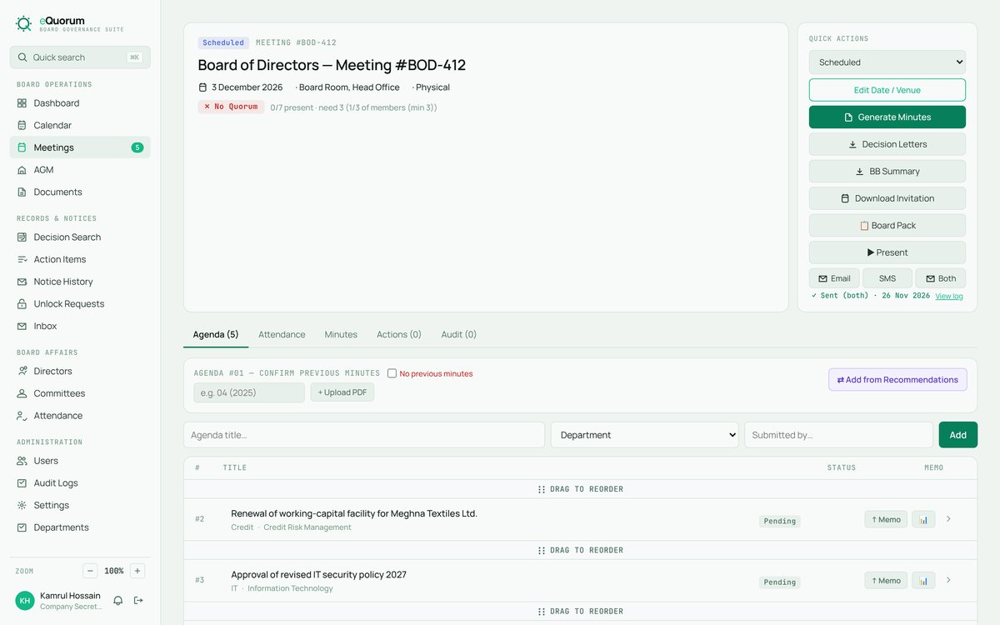
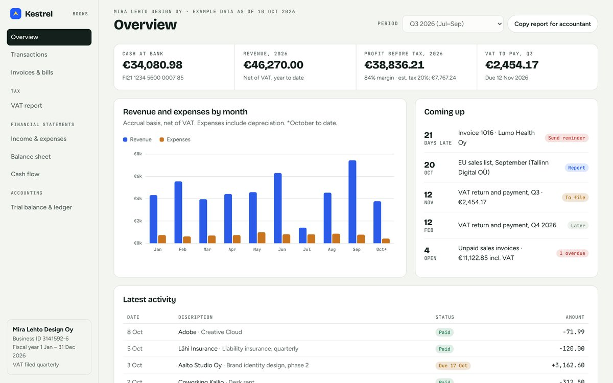
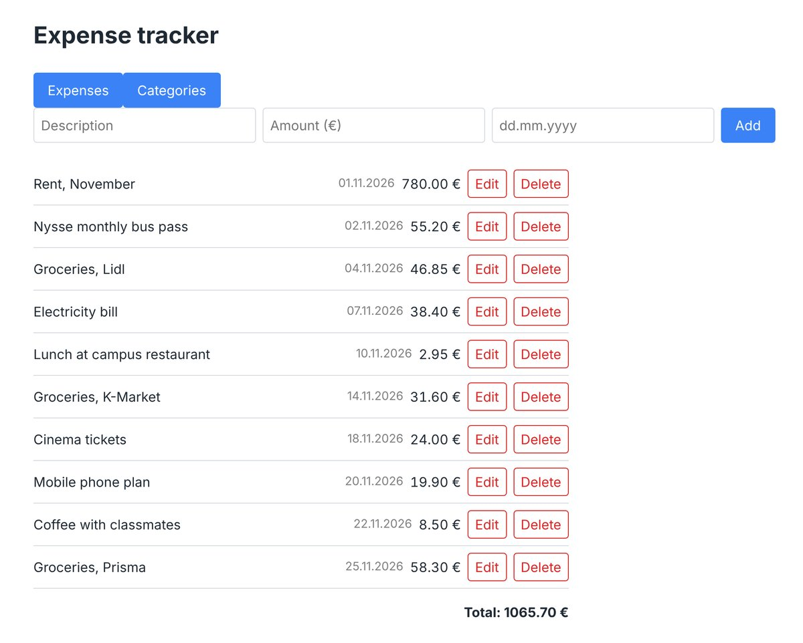

<!-- Header -->

  

  

  
  
  
  

---

## About me

Software engineering student at **TAMK** (Tampere University of Applied Sciences). I build full-stack and mobile products for real business problems: bookkeeping, board governance, mileage logs and agent ledgers.

- **Building:** an on-premise board governance platform for banks, with LLM-drafted minutes that never leave the bank's servers
- **Focus:** clean APIs, tested business logic (double-entry ledgers, VAT, approval rules) and production-ready deployment
- **Looking for:** a software developer internship or junior role in Finland

---

## Featured projects

<table>
  <tr>
    <td colspan="2" valign="top">
      <h3><a href="https://github.com/marahim34/eQuorum">eQuorum</a> · board governance platform for banks</h3>
       
      Runs the full board and committee lifecycle on the bank's own servers: notices, agendas, quorum and approval-limit checks, decisions, a resolution register and Word minutes. Parses department memos (credit, HR, audit, IT…) and drafts minutes with a <b>local LLM</b>, so no data leaves the bank. Role-based access, audit log with before/after records, Alembic migrations, CI.  
      
      
      
      
      
      
      
    </td>
  </tr>
  <tr>
    <td width="50%" valign="top">
      <h3><a href="https://github.com/marahim34/Kestrel">Kestrel</a></h3>
       
      Business account website and bookkeeping app for Finnish freelancers. Every report (VAT, P&amp;L, balance sheet, cash flow) comes from one tested double-entry ledger.  
      
      
      
    </td>
    <td width="50%" valign="top">
      <h3><a href="https://github.com/marahim34/wspb-26">Expense Tracker</a></h3>
       
      Production-style web app with CI, health checks, graceful shutdown, backup and restore, and an operations runbook.  
      
      
      
      
      
    </td>
  </tr>
  <tr>
    <td width="50%" valign="top">
      <h3><a href="https://github.com/marahim34/khata">Khata</a></h3>
      Offline Android ledger for mobile banking agents (bKash, Nagad, Rocket, Upay). Reads transaction SMS, calculates commission and exports PDF reports in English or Bangla.  
      
      
      
      
    </td>
    <td width="50%" valign="top">
      <h3><a href="https://github.com/marahim34/goodo-app">GoOdo</a></h3>
      Trip and mileage tracker with background GPS and Bluetooth auto-start, producing audit-ready logs for tax deductions and reimbursement.  
      
      
      
      
    </td>
  </tr>
</table>

---

## Backend APIs

| Project | What it shows | Stack |
|---|---|---|
| [**eQuorum API**](https://github.com/marahim34/eQuorum) | 20 API routers, role-based access, workflow state machines, document parsing pipeline, background scheduler, audit trail | FastAPI · SQLAlchemy · Alembic · PostgreSQL |
| [**Bookly**](https://github.com/marahim34/Bookly) | Bookkeeping REST API: invoices, income, expenses, balance sheet, monthly reports exported to PDF and Excel | Express 5 · Sequelize · PostgreSQL · JWT |
| [**Task Manager API**](https://github.com/marahim34/task-manager) | JWT auth with role-based access control, validation, admin endpoints | Express · MongoDB · Mongoose · Joi |
| [**Movie API**](https://github.com/marahim34/movie-api) | Modular CRUD API with JWT, Joi validation and query filtering | Express · MongoDB · JWT |

---

## Linux, servers &amp; embedded

| Project | What it is | Stack |
|---|---|---|
| [**Server Technologies**](https://github.com/marahim34/server-technologies) | Hardened Ubuntu server on CSC cPouta: Apache + HTTPS, reverse proxy, Node.js/PM2, Docker, NFS and Ansible, documented day by day. Includes a real Linux (Buildroot, kernel 6.8) running in the browser with 12 graded practice sets. | Linux · Apache · Docker · Ansible · v86 |
| [**Secure Pi Thesis Lab**](https://github.com/marahim34/embedded-project) | Study lab for post-quantum integrity on embedded Linux: Raspberry Pi Zero 2 W with TPM 2.0, Yocto read-only image, IMA/EVM with ML-DSA, Keylime attestation, signed A/B updates. Interactive simulations for PCR extend, IMA appraisal and TLS handshakes. | Embedded Linux · Yocto · TPM 2.0 · PQC |
| [**Linux systems programming**](https://github.com/marahim34/linux-systems-and-kernel-mastery/tree/main/code_examples) | C programs and kernel modules: epoll TCP server, thread pool, POSIX shared memory, Unix sockets, mmap indexer; char device, procfs, workqueue and RCU modules. | C · POSIX · Linux kernel modules · Bash |

---

## Tech stack

  <picture>
    <source media="(prefers-color-scheme: dark)" srcset="https://skillicons.dev/icons?i=py,ts,js,dart,java,cpp,fastapi,nodejs,express,react&theme=dark" />
    
  </picture>
   
  <picture>
    <source media="(prefers-color-scheme: dark)" srcset="https://skillicons.dev/icons?i=vite,flutter,postgres,sqlite,mongodb,docker,githubactions,linux,git,vscode&theme=dark" />
    
  </picture>

| Area | Tools |
|---|---|
| **Backend** | FastAPI, Node.js / Express, SQLAlchemy, Alembic, Sequelize, REST, JWT |
| **Frontend & mobile** | React, TypeScript, Vite, Flutter, Riverpod |
| **Data** | PostgreSQL, SQLite (Drift), MongoDB |
| **AI** | Ollama (local LLMs), LLM-drafted documents, memo parsing |
| **DevOps & Linux** | Docker Compose, GitHub Actions, Ansible, Apache, Linux servers |
| **Systems & embedded** | C, POSIX, Linux kernel modules, Raspberry Pi, Yocto, TPM 2.0 |

---

## GitHub analytics

  <picture>
    <source media="(prefers-color-scheme: dark)" srcset="https://github-readme-stats.vercel.app/api?username=marahim34&show_icons=true&include_all_commits=true&count_private=true&rank_icon=github&hide_border=true&theme=github_dark&bg_color=0d1117&title_color=58a6ff&icon_color=58a6ff" />
    
  </picture>
  <picture>
    <source media="(prefers-color-scheme: dark)" srcset="https://github-readme-stats.vercel.app/api/top-langs/?username=marahim34&layout=compact&langs_count=8&hide=html,css&hide_border=true&theme=github_dark&bg_color=0d1117&title_color=58a6ff" />
    
  </picture>

  <picture>
    <source media="(prefers-color-scheme: dark)" srcset="https://streak-stats.demolab.com/?user=marahim34&hide_border=true&background=0D1117&ring=58A6FF&fire=58A6FF&currStreakLabel=58A6FF&sideLabels=C9D1D9&currStreakNum=FFFFFF&sideNums=FFFFFF&dates=8B949E&stroke=30363D" />
    
  </picture>

  <picture>
    <source media="(prefers-color-scheme: dark)" srcset="https://github-readme-activity-graph.vercel.app/graph?username=marahim34&bg_color=0d1117&color=c9d1d9&title_color=58a6ff&line=58a6ff&point=ffffff&area=true&area_color=58a6ff&hide_border=true&custom_title=Contribution%20activity" />
    
  </picture>

<h3 align="center">Weekly coding time</h3>

  

  <picture>
    <source media="(prefers-color-scheme: dark)" srcset="https://raw.githubusercontent.com/marahim34/marahim34/output/snake-dark.svg" />
    
  </picture>

---

## Recent activity

<!--START_SECTION:activity-->
<!--END_SECTION:activity-->

  

